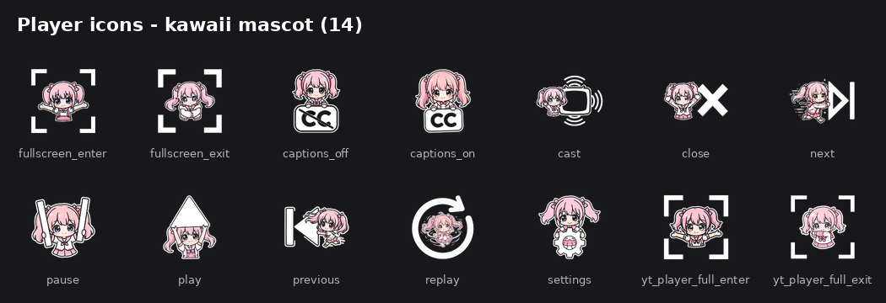
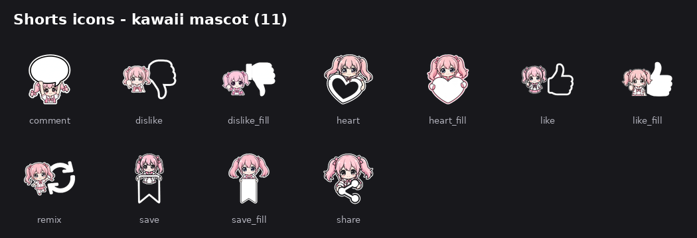
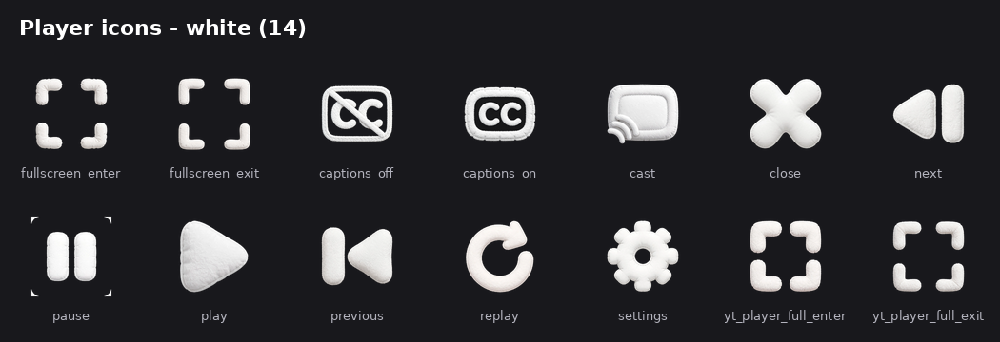
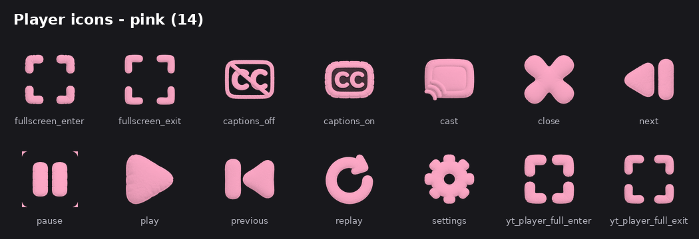

# Morphe Icon Packs

Kawaii mascot icon packs for [Morphe](https://github.com/MorpheApp/morphe-patches)-patched YouTube (Android). Drop-in ZIPs for the **Custom icons** option of the `Player icon style` and `Shorts icon style` patches.

## Packs

| File | Style | Icons | Description |
|------|-------|-------|-------------|
| `packs/kawaii-icons-chara.zip` | Player | 14 | Original pink kawaii mascot |
| `packs/kawaii-icons-shorts.zip` | Shorts | 11 (complete) | Shorts action icons, mascot style |
| `packs/kawaii-icons-white.zip` | Player | 14 | White variant |
| `packs/kawaii-icons-pink.zip` | Player | 14 | Pink variant |

## Preview

### Player — kawaii mascot

### Shorts — kawaii mascot

### Player — white

### Player — pink

All PNGs are 192x192 with transparency. Any icon not included in a pack falls back to the Automatic style, so partial packs work fine.

### Player pack contents (14)

`morphe_player_play`, `morphe_player_pause`, `morphe_player_next`, `morphe_player_previous`, `morphe_player_replay`, `morphe_player_settings`, `morphe_player_cast`, `morphe_player_captions_on`, `morphe_player_captions_off`, `morphe_player_close`, `morphe_fullscreen_enter`, `morphe_fullscreen_exit`

### Shorts pack contents (11, complete set)

`morphe_shorts_like`, `morphe_shorts_like_fill`, `morphe_shorts_dislike`, `morphe_shorts_dislike_fill`, `morphe_shorts_heart`, `morphe_shorts_heart_fill`, `morphe_shorts_comment`, `morphe_shorts_share`, `morphe_shorts_remix`, `morphe_shorts_save`, `morphe_shorts_save_fill`

## How to install

1. In the Morphe patcher, open the **Player icon style** (or **Shorts icon style**) patch option.
2. Choose **Custom icons** and select the ZIP.
3. Patch and install YouTube.
4. In YouTube: **Morphe settings → Player → Player icon style** (or **Shorts → Shorts icon style**) → select **Custom**.
5. Force-stop / restart YouTube.

## Notes

- File names follow the official naming from `docs/custom-icons` in morphe-patches; icons left out keep the Automatic style.
- Icon art is original, made for this repo — free to use and modify.
